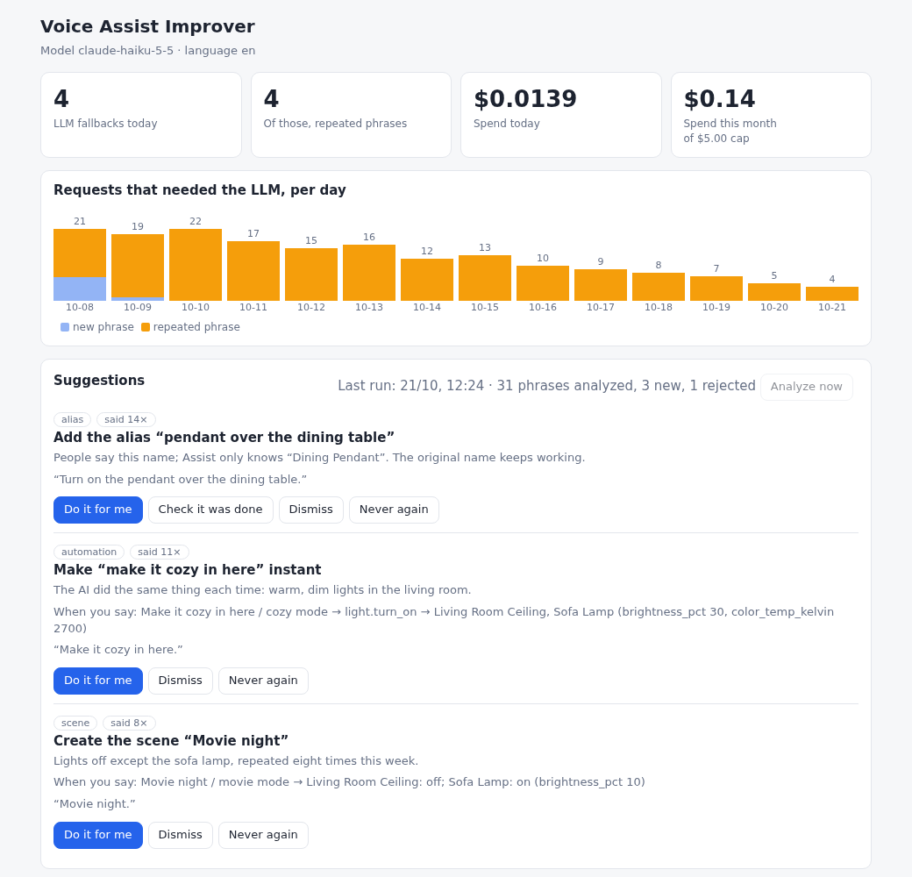

# Voice Assist Improver

**Makes Home Assistant's Assist need an LLM less and less.**

[![Add repository to my Home Assistant][badge]][add-repo]

[badge]: https://my.home-assistant.io/badges/supervisor_add_addon_repository.svg
[add-repo]: https://my.home-assistant.io/redirect/supervisor_add_addon_repository/?repository_url=https%3A%2F%2Fgithub.com%2Ffdaneluzzi%2Fvoice-assist-improver

Assist handles the commands it understands instantly, locally and for free. Anything it does not understand can
fall back to an LLM: powerful, but slow, paid, and needed again every time someone words the same request the
same way. Voice Assist Improver is that fallback, and it also **learns from it**: it records what Assist could
not handle and suggests the changes that let Assist handle it by itself next time.



*The panel inside Home Assistant (example data): requests that needed the LLM per day, and suggestions to review.*

> **Early release.** Tested by its author on Home Assistant OS. Expect rough edges and please report them.
> Not affiliated with Home Assistant, Nabu Casa or any AI provider.

## How it works

```
You speak ─► Assist ─ understood ─────────────────────────────► done (local, free)
               │
               └ not understood ─► Ollama agent ─► Voice Assist Improver ─► AI service (Anthropic API)
                                                        │                       │
                                                        │      reads and controls your home through
                                                        │      Home Assistant's MCP server
                                                        ├─ records the phrase
                                                        └─ every day: analyzes the phrases and suggests
                                                           aliases, automations and scenes
```

1. **It answers the fallback.** It looks like an Ollama server to Home Assistant, so nothing is installed inside
   Home Assistant. It calls the Anthropic API with your key, with the tools to read and control the entities you
   exposed to Assist, and with the prompt you choose.
2. **It teaches Assist.** Once a day it reads the recent fallbacks and proposes improvements. You review them in
   a panel inside Home Assistant.

The number that matters is on the panel: **how many requests needed the LLM each day, and how many of those
were phrases it had already seen.** If the suggestions work, it goes down.

## Suggestions

| Kind | Example | What *Do it for me* creates |
|---|---|---|
| **Alias** | "pendente da sala" is another name for *Sala Pendente* | the alias on the entity (the original name keeps working) |
| **Automation** | "luz baixa" should set the living room lights to 30 % | an automation with a sentence trigger |
| **Scene** | "modo cinema" | a scene, plus a sentence that activates it |
| **Tip** | advice you carry out yourself | nothing |

A model only *proposes*. Code validates each proposal when it is stored and again right before it is applied.
You always see the plan and confirm it, every change is written to an audit log, and **Undo** removes what was
created. *Dismiss* hides a suggestion for a while; *Never again* hides it for good.

## Requirements

- Home Assistant OS or Supervised (it runs as an app). Container and Core installs can run it as a normal
  container with a long-lived token; see the [documentation](voice_assist_improver/DOCS.md).
- The **Model Context Protocol Server** integration, which is how the voice agent reads and controls the home.
- The entities you want voice-controlled, **exposed to Assist**. The app sees nothing else.
- An **Anthropic API key**. Create it in the Anthropic Console, ideally in its own workspace with a low
  spending limit.

## Install

1. Click the button above (or Settings → Apps → App store → ⋮ → Repositories, and add
   `https://github.com/fdaneluzzi/voice-assist-improver`).
2. Install **Voice Assist Improver**, paste your API key in its **Configuration** tab, and start it.
3. Add the **Ollama** integration pointing at the app and select it in your voice pipeline, with *Prefer
   handling commands locally* on. The exact steps are in [voice_assist_improver/DOCS.md](voice_assist_improver/DOCS.md).

## Settings

| Option | Default | |
|---|---|---|
| `anthropic_api_key` | | Your API key |
| `anthropic_workspace_id` | | Only if your key is not tied to a workspace |
| `language` | `en` | `en` or `pt-BR`: built-in prompt, spoken messages and panel |
| `model` | `claude-haiku-5-5` | Model for the voice answers. Any model ID your key can use |
| `analysis_model` | `claude-sonnet-5-5` | Model for the daily analysis |
| `monthly_budget_usd` | `5` | Estimated spend that stops AI calls for the month. `0` disables the cap |
| `web_search` | `false` | Let the model search the web |
| `voice_tool_denylist` | `[]` | Tool names to hide from the voice agent (patterns like `light__*`) |
| `retention_days` | `30` | How long recorded requests are kept |
| `analysis_hour` | `4` | Local hour of the daily analysis (`-1` turns it off) |

To change the voice prompt, put a `voice_prompt.md` in the app's config folder. Models are free text on purpose:
a new model works the day it exists, and the panel warns you if the ID is not available to your key.

## Cost

You pay Anthropic directly. With the small default model a voice request typically costs a fraction of a cent,
and the daily analysis about a cent. The panel shows the estimated spend; the monthly cap is a safeguard, not
a billing guarantee, so set a spending limit in the Anthropic Console as well.

## Privacy and safety

- **What leaves your home:** for each fallback, what was said, the conversation so far, and the state of the
  entities the model asks about go to Anthropic. For the daily analysis, the recent phrases and the names of
  your exposed entities. Nothing else.
- **What stays:** requests are stored locally in the app's data folder and deleted after `retention_days`.
- **Exposure is the control.** An entity you did not expose to Assist is invisible to the app. Keep alarms,
  locks and gates unexposed if you do not want them voice-controlled. Exposure is all-or-nothing per entity:
  exposing a lock so you can ask whether it is locked also lets the voice agent try to operate it.
- **Validated changes only.** Created automations and scenes can only use a short list of services on lights,
  switches, fans, covers, climate, media players and valves. There is no service for locks or alarms in it.
- Web search is off by default: text from the web can try to give instructions to a model that also controls
  your home. The built-in prompt tells the model to ignore them.

## Limitations

- One AI provider for now (the Anthropic API). The backend is an interface, so others can be added.
- English and Brazilian Portuguese. Rule-based area aliases ("o pendente da sala") exist for Portuguese only.
- It cannot fix speech recognition: if the transcription is wrong, the phrase is wrong. The panel shows what
  was heard so you can spot it.
- Suggestions need repetition to be useful; with a few requests a day, expect few at first.

## Contributing

Issues and pull requests are welcome. See [docs/DEVELOPMENT.md](docs/DEVELOPMENT.md) to run it from a checkout and
[docs/DECISIONS.md](docs/DECISIONS.md) for why it is built the way it is. A Portuguese version of this page is in
[README.pt-BR.md](README.pt-BR.md).

## Support

Voice Assist Improver is free and maintained in spare time. If it helps you, a coffee is appreciated, and
so is a star on the repository.

[](https://buymeacoffee.com/fdaneluzzi)

## License

Apache-2.0. See [LICENSE](LICENSE).
